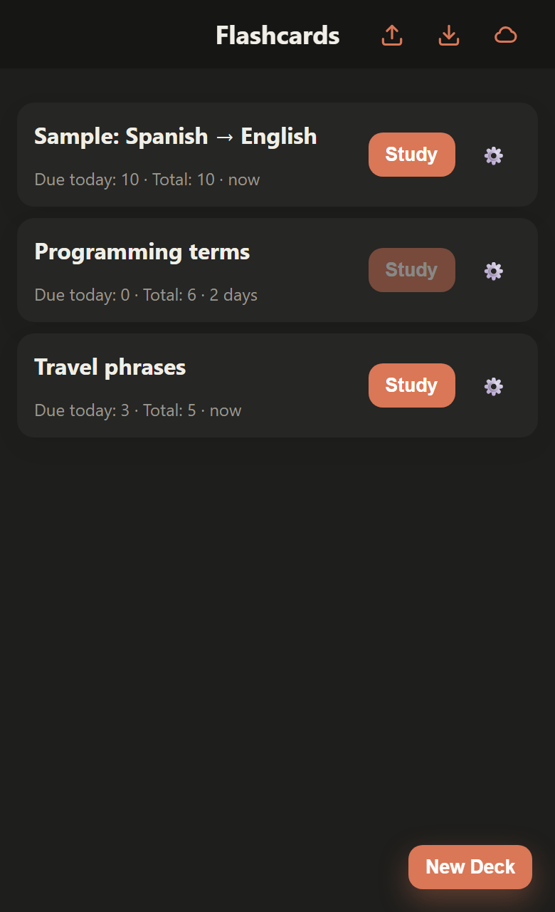
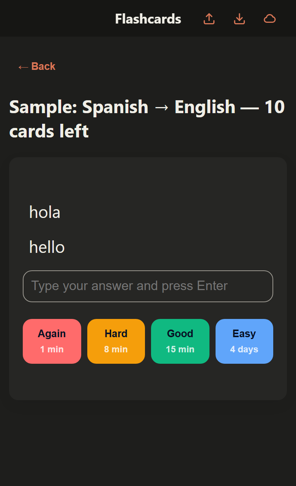
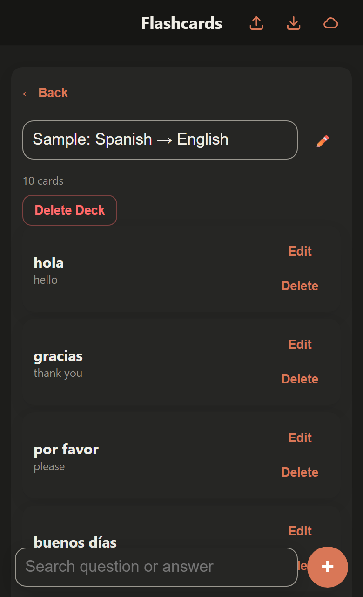
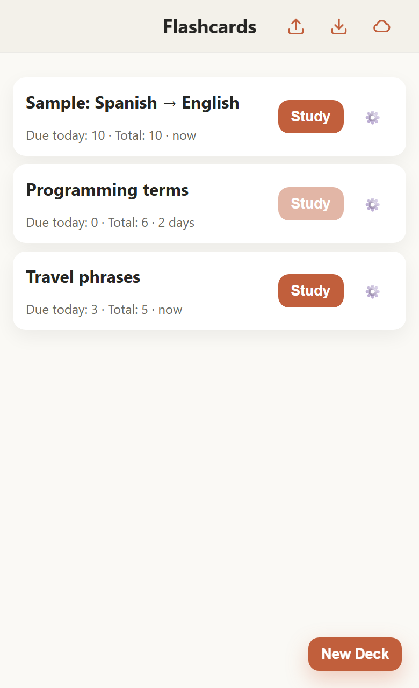

# Flashcards — an offline-first spaced-repetition PWA

A small Anki-style flashcards app that installs on your phone, works with no connection, and can optionally sync your decks across devices. Built with **vanilla JavaScript, no framework and no build step**.

**[Live demo →](https://flash-cards-theta-steel.vercel.app/)** (works without an account: tap *Load sample deck* on the empty screen)

<table>
  <tr>
    <td></td>
    <td></td>
    <td></td>
    <td></td>
  </tr>
  <tr>
    <td align="center">Decks</td>
    <td align="center">Study</td>
    <td align="center">Manage</td>
    <td align="center">Light theme</td>
  </tr>
</table>

## Why I built it

I wanted my own vocabulary on my iPhone, PC and iPad without depending on a store app. It doubled as a way to practice the parts of the web platform that usually get skipped in tutorials: service workers, installable PWAs, iOS Safari quirks, and syncing local-first data without writing a backend.

## Features

- **Spaced repetition** with four ratings (*Again / Hard / Good / Easy*). Each button previews when the card will come back.
- **Learning steps in minutes**, then day-scale review intervals with a per-card ease factor (details below).
- **Live study queue:** cards whose cooldown expires *during* a session are pulled into it automatically, like Anki's relearning steps.
- **Offline-first PWA:** installable, fully usable with no network.
- **Optional cloud sync** across devices with Google sign-in (Firebase). If you never sign in, nothing leaves your device.
- **JSON export / import** as a backup that doesn't depend on any cloud.
- Create, rename, search, edit and delete decks and cards; dark and light themes that follow the OS.
- Type-your-answer mode: type a guess before revealing the answer.

## How scheduling works

A card is either in **learning** or in **review**.

| State | Again | Hard | Good | Easy |
|---|---|---|---|---|
| Learning | 1 min | 8 min | 15 min, then 1 day (graduates) | 4 days (graduates) |
| Review | 1 min (relearn) | interval × 1.2 | 6 days on the 2nd success, then interval × ease | ~1.3 × the *Good* interval |

The ease factor starts at 2.5, drops on *Again*/*Hard*, rises on *Easy*, and never goes below 1.3. When a session starts, due cards are ordered from the longest interval to the shortest, so short learning steps land at the end and have time to come due again within the same session.

## Technical notes

The decisions that were most interesting to work through:

- **Local-first data flow.** `localStorage` is always the source of truth the UI reads from, so rendering is synchronous and the app is instant offline. Every mutation goes through one function (`saveDecks`), which is also the single hook that pushes to the cloud. Sync was added without touching any call site.
- **Sync as an optional layer.** One Firestore document per user holds the decks array; a snapshot listener applies remote changes through the same save/render path, with a guard flag to avoid push-back loops. With no Firebase config the sign-in button never appears and no network calls are made.
- **iOS Safari and Firebase Auth.** `signInWithRedirect` silently failed on iPhone: tracking prevention blocks the storage the redirect round-trip depends on. Switching to `signInWithPopup` (with a redirect fallback) fixed it.
- **Service worker strategy.** Network-first for the app shell so updates arrive quickly, cache-first for static assets, and cross-origin requests are never intercepted. An earlier version cached Firebase traffic, which would have broken auth and made real-time sync serve stale data.
- **Keyboard-aware docked search bar.** iOS Safari doesn't reflow `position: fixed` elements when the on-screen keyboard opens, so the bar listens to `window.visualViewport` and translates itself above the keyboard.
- **Data migration.** Stored data is normalised on load (missing fields, legacy shapes), with an automatic backup copy restored if the main entry is corrupted.

## Project structure

```
index.html          app shell and markup
app.js              data layer, scheduler, cloud sync and UI
firebase-init.js    optional Firebase setup (ES module, exposes helpers on window)
sw.js               service worker
style.css           theming (CSS variables) and layout
manifest.json       PWA manifest
firestore.rules     security rules for the sync document
icons/              SVG + PNG icons (iOS touch icon, maskable)
docs/screenshots/   images used in this README
```

## Run locally

No install or build is needed; any static file server works.

```bash
python -m http.server 8000
# or
npx serve .
```

Open `http://localhost:8000`. Service workers need `localhost` or HTTPS. To try it on a phone, serve it over HTTPS (for example through a tunnel, or by deploying to a static host such as Vercel or GitHub Pages) and use *Share → Add to Home Screen* on iOS.

## Enable cloud sync (optional)

`firebase-init.js` ships with the author's project config. To use your own project:

1. Create a project at the [Firebase console](https://console.firebase.google.com/).
2. **Authentication → Sign-in method:** enable **Google**.
3. **Firestore Database:** create a database (Standard edition, production mode).
4. Publish the rules in [`firestore.rules`](firestore.rules) (Firestore → Rules tab, or `firebase deploy --only firestore:rules`).
5. **Project settings → Your apps → Web app:** copy the config object into `firebase-init.js`.
6. **Authentication → Settings → Authorized domains:** add the domain where you host the app.
7. Recommended: in Google Cloud Console, restrict the browser API key to your domains.

Firebase web config values identify the project, they are not secrets; access is enforced by the security rules.

## Data model

```json
[
  {
    "id": "1789478310908",
    "name": "Spanish → English",
    "cards": [
      {
        "id": "178947831090945b5",
        "question": "hola",
        "answer": "hello",
        "state": "NEW",
        "reps": 0,
        "interval": 0,
        "easeFactor": 2.5,
        "lastEvaluation": "",
        "nextReview": "2026-09-15T13:18:30.909Z"
      }
    ]
  }
]
```

The same array is what the JSON export produces and what is stored in Firestore.

## Known limitations and roadmap

I'd rather be upfront about what this is: a personal project, not a polished product.

- **Sync is last-write-wins** on the whole decks array. Editing offline on two devices and then syncing can overwrite one set of changes. Merging per card (by id and timestamp) is the natural next step.
- **No automated tests yet.** The scheduler (`calculateSchedule`) is the most valuable thing to cover first.
- **`app.js` is a single file.** Splitting it into ES modules (storage, scheduler, sync, UI) is planned.
- The viewport disables pinch-zoom on purpose, to feel like a native iOS app; that is a trade-off against accessibility.

## License

[MIT](LICENSE) © Julian Agudelo
